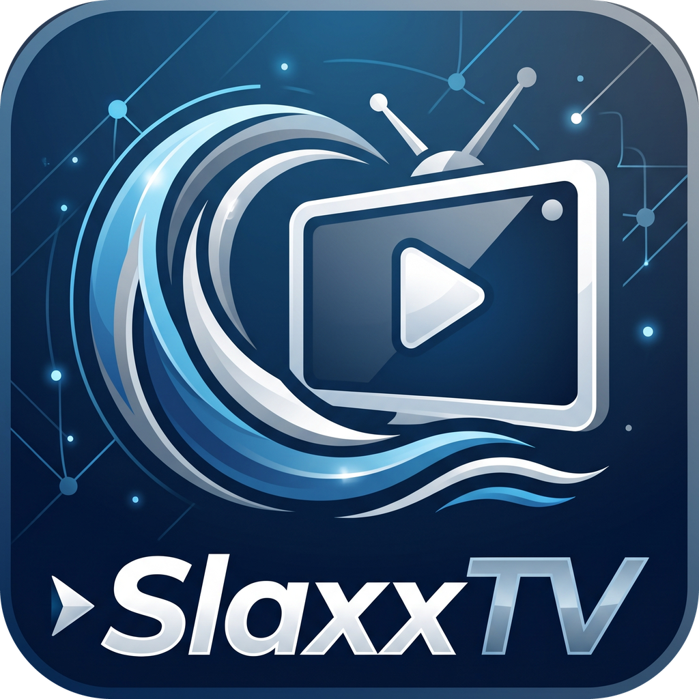

# SlaxxTV 0.7b

Watch free-to-air internet TV channels from all over the world.
Windows · Linux · macOS · Android

*Written by IT-Dummkopfen with the help of an AI.*



## Download

Ready-to-run builds are on the [Releases page](https://github.com/IT-DUMMKOPFEN/SurfTV/releases):

| System | File |
|---|---|
| Windows | `SlaxxTV-windows-x64.zip` – unzip, start `slaxxtv.exe` |
| macOS | `SlaxxTV-macos.zip` – not signed: right-click › Open the first time |
| Linux | `SlaxxTV-linux-x64.tar.gz` – needs libmpv (`sudo apt install libmpv2`) |
| Android | `SlaxxTV-android.apk` – allow installing from unknown sources |

Every push to `main` is built by GitHub Actions (see the *Actions* tab).

## Features

### Two interfaces – switch with **F1** (or the switch in the settings / on the remote)

**TV like** – feels like a modern smart TV:
- Top bar: Update (channel list update / test), Discover (countries → channels), Live TV, My Channels (favorites), Categories (Movies, Series, Docu, News, Music → countries → channels), volume – % +, fullscreen, name search (magnifier), settings (gear)
- Live TV: channel name, flag, **Watch Live** (picture fills the window) and **+ Favorite**, the running stream next to it; below: My Channels and the categories as swipeable rows
- Channel tiles with logo (if available), name and flag – swipe with mouse or finger
- Arrow left: channel list, arrow right: remote control
- The last selection is always shown in the middle again
- Settings, English help and info page
- **Program guide** for the channels in My Channels (now / next on Live TV, tiles, remote display; full guide on the My Channels page or with **G**). Source: [epgshare01](https://epgshare01.online/epgshare01/) – not every channel has guide data
- **Export / Import** of My Channels and the keys 0–9 as a JSON file

**Classic** – the original layout:

- All channels sorted by country, with flag and country name (left)
- TV picture in the middle, always a 16:9 screen. 4:3 channels are shown centered with black bars, like on a real TV
- Remote control on the right:
  - LCD display with channel name, country flag and VPN hint
  - CH ▲▼ zapping, VOL +/–, volume slider, mute
  - Keys 0–9: **tap** = recall channel, **hold** = store the current channel
  - Day / night mode, fullscreen, **Update** (channel search)
- Channel search: downloads the public lists and tests every stream, like the channel search on a TV. It shows a live counter with channel name and country. **Stop** keeps the channels found so far.
- VPN hint: channels marked *geo-blocked* in the lists, or that answered "access denied" during the search
- VPN filter: **All / No VPN / VPN only**
- Categories: **Movies, Series, Docu, News, Music** – all countries with their channels of that kind
- **Update** reads in the complete newest channel lists (all channels); **Test** then keeps only the working ones
- **Test my channels** (Quick or Intensive): streams that do not answer are removed from the list. Runs in the background – TV keeps playing
- **Update** keeps the current stream running
- Ships with a channel list that was tested by GitHub Actions, so channels are there on the first start
- Search by channel or country
- Resizable window, fullscreen with button (bottom right), **F**, **F11** or double-click; leave with **Esc**

### Keyboard

| Key | Action |
|---|---|
| Esc | Leave fullscreen |
| F / F11 / double-click | Fullscreen on/off |
| ↑ / ↓, PgUp / PgDn | Next / previous channel |
| + / – | Volume |
| M | Mute |
| 0–9 | Stored channel |

## Channel sources

- iptv-org – https://github.com/iptv-org/iptv (JSON API, includes the "Geo-blocked" label)
- Free-TV – https://github.com/Free-TV/IPTV (YouTube live channels marked Ⓨ are listed under YouTube)
- Famelack (ex tv.garden) – https://github.com/famelack/famelack-channels (incl. many 24/7 YouTube live streams)
- FreetuxTV database – https://database.freetuxtv.net (WebTV, status "Working")

YouTube channels are listed as country **YouTube** (Classic) and on the **Live YT** page (TV like).
**--own--** holds your own stream addresses and is always on top of the list.

The channel list is saved in the app support folder (`channels.json`).
Settings and the keys 0–9 are saved with shared_preferences.

## Build

You need the Flutter SDK (3.27 or newer).

```bash
cd surftv
python3 tool/setup_platforms.py     # once: creates the platform folders + patches them
flutter pub get
flutter run                          # or: flutter run -d windows / macos / linux / <android device>
```

Release builds:

```bash
flutter build windows
flutter build macos
flutter build linux
flutter build apk
```

### Linux

The player uses libmpv:

```bash
sudo apt install libmpv-dev mpv      # Debian / Ubuntu
```

### Notes

- Android needs plain-HTTP streams allowed. The setup script sets `usesCleartextTraffic` and the internet permission.
- macOS needs the network client entitlement. The setup script adds it.
- Flags are loaded from flagcdn.com, because Windows cannot show flag emojis.

## Project structure

```
lib/
  main.dart                 app, layout, keyboard
  app_state.dart            channels, player, volume, keys 0-9, theme, fullscreen
  channel_scanner.dart      download lists + test streams (channel search)
  models.dart               Channel, ChannelDb
  storage.dart              save/load channel list
  widgets/
    channel_list.dart       left: countries + channels
    tv_screen.dart          middle: 16:9 TV picture, OSD, fullscreen button
    remote_control.dart     right: remote control
    scan_dialog.dart        channel search window
    flag.dart               flag image + VPN badge
tool/setup_platforms.py     platform setup
```
